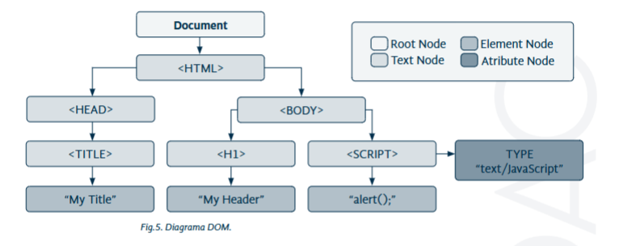

# Tema 4 — Lenguajes de script cliente y servidor

> **Idea clave:** hay dos sitios donde se puede ejecutar código de una web. **JavaScript** se ejecuta en el **navegador** (cliente). **PHP** se ejecuta en el **servidor**, y al navegador solo le llega el HTML que genera.

| | JavaScript | PHP |
|--|-----------|-----|
| ¿Dónde se ejecuta? | En el **navegador** (tu ordenador) | En el **servidor** |
| ¿Qué necesito para probarlo? | Solo el navegador | Un servidor: **XAMPP** (Tema 6) |
| ¿Para qué sirve? | Que la página reaccione: botones, mensajes, cambiar textos | Procesar formularios, leer bases de datos |
| ¿Cómo se escribe? | `<script> ... </script>` | `<?php ... ?>` |

> 📌 **Antes de este tema** hemos visto el [Tema 6](../tema06/apuntes.md): ya tienes XAMPP instalado y la base de datos `biblioteca` creada. La **Parte A** (JavaScript) no lo necesita; las **Partes B** (PHP) sí.

## Índice

**Parte A: JavaScript en el navegador**
1. [Dónde se escribe JavaScript](#1-dónde-se-escribe-javascript)
2. [El DOM: la página como un árbol](#2-el-dom-la-página-como-un-árbol)
3. [Buscar y cambiar elementos](#3-buscar-y-cambiar-elementos)
4. [Crear elementos nuevos](#4-crear-elementos-nuevos)
5. [Funciones y botones](#5-funciones-y-botones)


**Parte B: PHP en el servidor**
6. [Dónde se escribe PHP](#6-dónde-se-escribe-php)
7. [Variables](#7-variables)
8. [Funciones](#8-funciones)
9. [Recibir datos de un formulario](#9-recibir-datos-de-un-formulario)

[Resumen final](#resumen-final)

---

## Parte A: JavaScript en el navegador

Los ejemplos de esta parte están en [`ejemplos/javascript/`](ejemplos/javascript/). 

### 1. Dónde se escribe JavaScript

El código JavaScript va dentro de la etiqueta `<script>`. Si no la pones, el navegador cree que es texto y lo escribe tal cual en la página.

**Opción 1: dentro del HTML**

```html
<!DOCTYPE html>
<html lang="es">
<head>
    <meta charset="UTF-8">
    <title>Mi primer código JavaScript</title>
</head>
<body>
    <h1>Mi primer código JavaScript</h1>
    <script>
        document.write("Hola Mundo");
    </script>
</body>
</html>
```

`document.write("...")` escribe un texto en la página.

**Opción 2: en un fichero aparte** ✅ (como hicimos con el CSS)

```html
<script src="js/script.js"></script>
```

```
ejemplos/javascript/
├── ejemplo1.html     ← <script src="js/script.js">
└── js/
    └── script.js     ← aquí va el código JavaScript
```

> ⚠️ Pon el `<script>` **al final del `<body>`**. JavaScript se ejecuta en cuanto el navegador lo lee: si está arriba, intenta buscar elementos que todavía no existen.

**Comentarios** en JavaScript:

```javascript
// Comentario de una línea
/* Comentario
   de varias líneas */
```

---

### 2. El DOM: la página como un árbol

Para el navegador, una página HTML es un **árbol** de elementos metidos unos dentro de otros. Ese árbol se llama **DOM** (*Document Object Model*). Cada pieza del árbol es un **nodo**.



| Tipo de nodo | Qué es | En el dibujo |
|--------------|--------|--------------|
| **Document** | La raíz: la página entera | `Document` |
| **Element** | Una etiqueta | `<html>`, `<body>`, `<h1>`... |
| **Text** | El texto que hay dentro de una etiqueta | `"My Title"`, `"My Header"` |
| **Attr** | Un atributo de una etiqueta | `type="text/JavaScript"` |
| **Comment** | Un comentario `<!-- -->` | — |

> 💡 Abre cualquier página, pulsa **F12 → Elementos**: lo que ves, con sus flechas para desplegar, **es el DOM**.

JavaScript usa el DOM para **buscar** un elemento de la página y **cambiarlo**.

---

### 3. Buscar y cambiar elementos

| Función | Qué busca | Ejemplo |
|---------|-----------|---------|
| `getElementById("id")` | **El** elemento con ese id (solo uno) | `document.getElementById("texto")` |
| `getElementsByTagName("etiqueta")` | Todos los elementos de esa etiqueta | `document.getElementsByTagName("p")` |
| `getElementsByName("nombre")` | Todos los que tienen ese `name` | `document.getElementsByName("prueba")` |
| `getElementsByClassName("clase")` | Todos los que tienen esa clase | `document.getElementsByClassName("aviso")` |

> ⚠️ Fíjate: es `getElementById`, con **Element en singular**, porque solo puede haber un elemento con cada id. Las demás llevan **Elements** en plural. En el libro aparece `getElementsById`: esa función **no existe** y da error.

**Ejemplo: cambiar el texto de un párrafo**

```html
<p id="texto">Texto original</p>

<script>
    var elem = document.getElementById("texto");        // 1. busco el párrafo
    elem.innerHTML = "Texto modificado con JavaScript";  // 2. cambio lo que tiene dentro
</script>
```

```
 Antes:  Texto original
 Después: Texto modificado con JavaScript
```

- `var elem = ...` guarda el elemento en una **variable** llamada `elem`, para usarlo después.
- `innerHTML` es "lo que hay dentro" de la etiqueta.

**Cambiar el estilo** (como hacíamos con CSS, pero desde JavaScript):

```javascript
document.getElementById("texto").style.color = "red";
document.getElementById("texto").style.backgroundColor = "yellow";
```

> En JavaScript, las propiedades CSS con guion se escriben **sin guion y con mayúscula**: `background-color` → `backgroundColor`, `font-size` → `fontSize`.

---

### 4. Crear elementos nuevos

| Función | Qué hace |
|---------|----------|
| `document.createElement("p")` | Crea una etiqueta nueva (todavía no se ve) |
| `document.createTextNode("texto")` | Crea un texto |
| `padre.appendChild(hijo)` | Mete el hijo **dentro** del padre (ahora sí se ve) |

**Ejemplo: añadir un párrafo dentro de una caja vacía**

```html
<div id="contenedor"></div>

<script>
    var nuevo = document.createElement("p");                                       // <p></p>
    var texto = document.createTextNode("Este párrafo fue creado dinámicamente."); // el texto
    nuevo.appendChild(texto);                                     // <p>Este párrafo...</p>

    var caja = document.getElementById("contenedor");             // busco la caja
    caja.appendChild(nuevo);                                      // meto el <p> en la caja
</script>
```

```
 Antes:  <div id="contenedor"></div>
 Después: <div id="contenedor"><p>Este párrafo fue creado dinámicamente.</p></div>
```

> 🔍 **Pruébalo:** abre [`ejemplo1.html`](ejemplos/javascript/ejemplo1.html), pulsa **F12 → Elementos** y busca el `div`. Verás el `<p>` nuevo dentro, aunque **no está** en el fichero HTML: lo ha creado JavaScript.

---

### 5. Funciones y botones

Una **función** es un trozo de código con nombre que se ejecuta **cuando lo llamas**, no antes.

```javascript
function pulsar() {
    alert("Hola, bienvenido a una página habladora");
}
```

`alert("...")` muestra una ventanita con un mensaje.

Para que se ejecute al **hacer clic** en un botón, se usa el atributo `onclick`:

```html
<input type="button" id="button1" value="Púlsame" onclick="pulsar()">
```

**Ejemplo completo**

```html
<head>
    <script>
        function pulsar() {
            alert("Hola, bienvenido a una página habladora");
            document.getElementById("button1").style.backgroundColor = "red";
        }
    </script>
</head>
<body>
    <form>
        <input type="button" id="button1" value="Púlsame" onclick="pulsar()">
    </form>
</body>
```

---

## Parte B: PHP en el servidor

> ⚠️ Para esta parte necesitas **XAMPP instalado y Apache encendido** 

Los ejemplos están en [`ejemplos/php/`](ejemplos/php/). **No se abren con Live Server**:

1. Copia la carpeta `php` dentro de `C:\xampp\htdocs\` y llámala `tema04`.
2. Abre el navegador y escribe: `http://localhost/tema04/ejemplo1.php`

```
 Live Server (127.0.0.1:5500)  →  solo entiende HTML, CSS y JavaScript
 XAMPP       (localhost)       →  además ejecuta PHP
```

> ⚠️ Si abres un `.php` con doble clic, el navegador te enseña el **código** o te lo descarga, pero no lo ejecuta. Siempre por `http://localhost/...`

### 7. Dónde se escribe PHP

El código PHP va entre `<?php` y `?>`. Todo lo que está **fuera** es HTML normal. El fichero tiene que tener extensión **`.php`**.

**Opción 1: dentro del HTML**

```php
<body>
    <?php
        echo "Hola Mundo";
    ?>
</body>
```

`echo` escribe un texto en la página (es el `document.write` de PHP). **Cada instrucción acaba en `;`**.

**Opción 2: traer otro fichero con `include`**

```php
<?php include("hola.php"); ?>
```

Es como "copiar y pegar" el contenido de `hola.php` en ese punto. Muy útil para el menú o el pie: se escriben una vez y se incluyen en todas las páginas.

`require("hola.php")` hace lo mismo, pero si no encuentra el fichero **se para** con un error. `include` solo avisa y sigue.

> 🔍 **Pruébalo:** abre `http://localhost/tema04/ejemplo1.php` y pulsa **Ctrl + U** (ver código fuente). **No verás nada de PHP**: solo el HTML que PHP ha generado. Es lo que vimos en el Tema 1: el PHP se queda en el servidor.

---

### 8. Variables

Una **variable** es una "caja con nombre" donde guardas un dato.

```php
<?php
    $nombre = "Pepe";      // texto: entre comillas
    $edad = 17;            // número: sin comillas

    echo "Me llamo $nombre y tengo $edad años";
?>
```

```
 Me llamo Pepe y tengo 17 años
```

Reglas:

| Regla | Correcto | Incorrecto |
|-------|----------|------------|
| Empiezan por `$` | `$nombre` | `nombre` |
| Después, una letra o `_` | `$var`, `$_var` | `$1var` |
| Mayúsculas ≠ minúsculas | `$Var` y `$var` son **dos** variables distintas | — |

Para **unir** textos se usa el **punto** `.`:

```php
echo "Hola " . $nombre . ", bienvenido";
```

---

### 9. Funciones

Igual que en JavaScript: un trozo de código con nombre que se ejecuta cuando lo llamas.

**Función que recibe datos (parámetros)**

```php
<?php
    function saludar($nombre, $apellido) {
        echo "Hola $nombre $apellido<br>";
    }

    saludar("Pepe", "García");    // Hola Pepe García
    saludar("García", "Pepe");    // Hola García Pepe  ← ¡el orden importa!
?>
```

**Función que devuelve un resultado (`return`)**

```php
<?php
    function suma($a, $b) {
        return $a + $b;
    }

    echo suma(5, 3);              // 8
?>
```

| | Sin `return` | Con `return` |
|--|--------------|--------------|
| Qué hace | Hace algo (por ejemplo, un `echo`) | **Devuelve** un valor para usarlo después |
| Ejemplo | `saludar("Pepe")` | `$total = suma(5, 3);` |

---

### 10. Recibir datos de un formulario

Aquí se juntan el **Tema 2** (formularios) y PHP. El formulario envía los datos a un fichero PHP, y PHP los recoge.

**`formulario.html`**

```html
<form action="comparador.php" method="get">
    Primer valor: <input type="text" name="valor1"><br>
    Segundo valor: <input type="text" name="valor2"><br>
    <input type="submit" value="Comparar">
</form>
```

**`comparador.php`**

```php
<?php
    $n1 = intval($_GET['valor1']);    // recojo el campo con name="valor1"
    $n2 = intval($_GET['valor2']);    // recojo el campo con name="valor2"

    if ($n1 > $n2) {
        echo "El número mayor es $n1";
    } else {
        echo "El número mayor es $n2";
    }
?>
```

```
 formulario.html                         comparador.php
 ┌──────────────────────┐
 │ Primer valor:  [ 8 ] │   action="comparador.php"
 │ Segundo valor: [ 3 ] │ ─────────────────────────►  $_GET['valor1'] → 8
 │ [Comparar]           │   ?valor1=8&valor2=3        $_GET['valor2'] → 3
 └──────────────────────┘                             "El número mayor es 8"
```

- `$_GET['valor1']` recoge el dato cuyo **`name`** es `valor1`. Si el formulario usa `method="post"`, sería `$_POST['valor1']`.
- `intval()` convierte el texto en número entero.
- `if (...) { } else { }`: si se cumple la condición, hace lo primero; si no, lo segundo.

> 🔍 **Pruébalo:** después de pulsar Comparar, mira la barra de direcciones: `comparador.php?valor1=8&valor2=3`. Son los datos viajando por GET, igual que en el Tema 2.

---


## Resumen final

**JavaScript (navegador)**

| Quiero... | Código |
|-----------|--------|
| Escribir código JS | `<script> ... </script>` o `<script src="js/script.js">` |
| Escribir en la página | `document.write("Hola")` |
| Mostrar un mensaje | `alert("Hola")` |
| Buscar por id | `document.getElementById("id")` |
| Cambiar el texto | `elem.innerHTML = "nuevo"` |
| Cambiar el estilo | `elem.style.color = "red"` |
| Crear y añadir un elemento | `createElement`, `createTextNode`, `appendChild` |
| Ejecutar algo al hacer clic | `onclick="funcion()"` |

**PHP (servidor)**

| Quiero... | Código |
|-----------|--------|
| Escribir código PHP | `<?php ... ?>` en un fichero `.php` |
| Escribir en la página | `echo "Hola";` |
| Incluir otro fichero | `include("menu.php");` |
| Crear una variable | `$nombre = "Pepe";` |
| Unir textos | `"Hola " . $nombre` |
| Recoger un dato de formulario | `$_GET['name']` o `$_POST['name']` |


