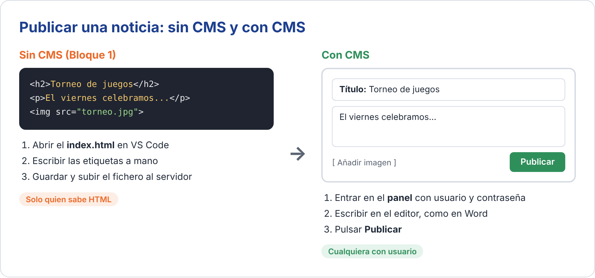
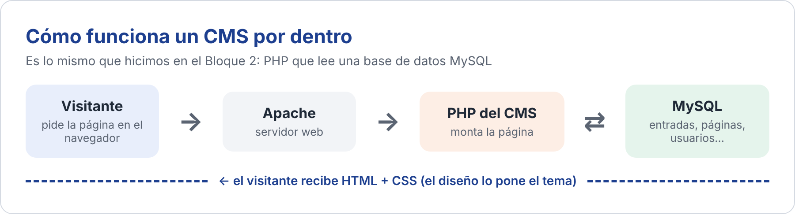
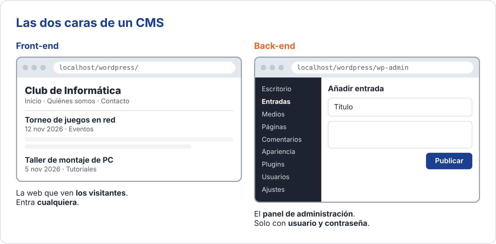
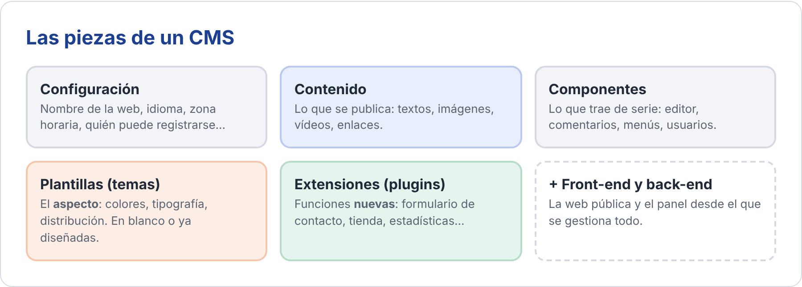
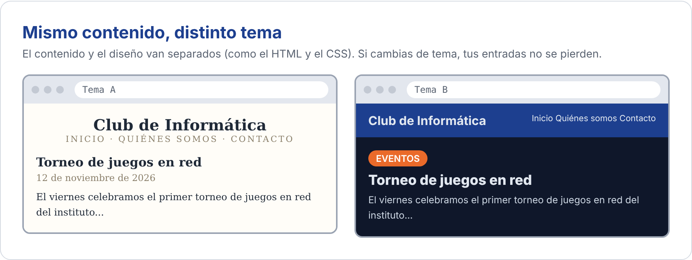
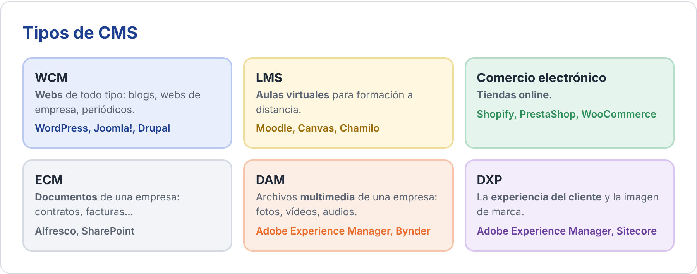
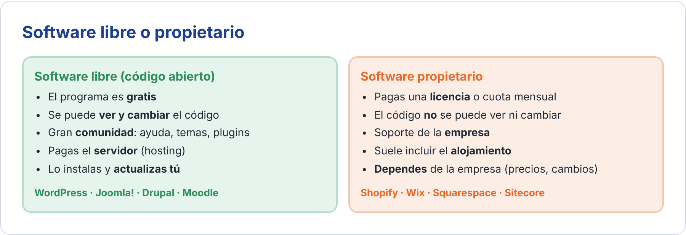
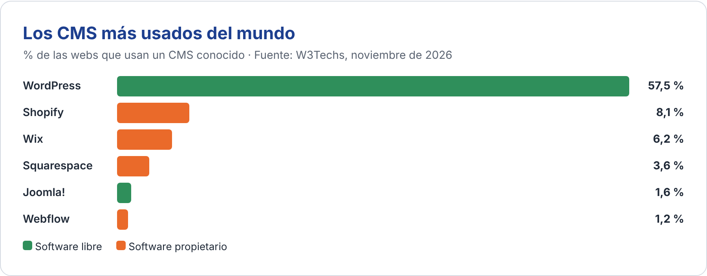
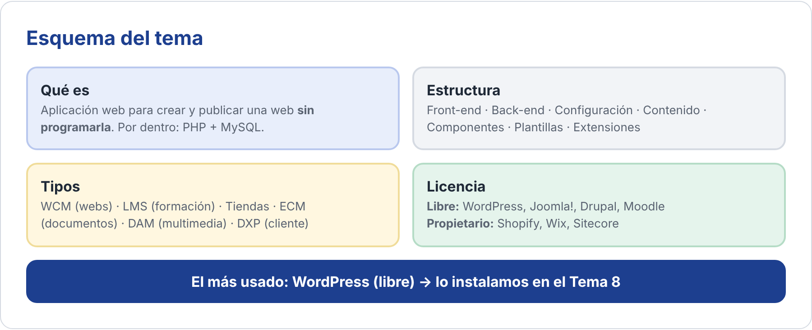

# Tema 7 — Los gestores de contenido (CMS)

> **Idea clave:** un **CMS** (*Content Management System*, gestor de contenidos) es una **aplicación web para crear y publicar una web sin programarla**. Escribes en un editor, como en Word, y el CMS genera las páginas.

## Índice

1. [Qué es un CMS](#1-qué-es-un-cms)
2. [Cómo funciona por dentro](#2-cómo-funciona-por-dentro)
3. [Estructura de un CMS](#3-estructura-de-un-cms)
4. [Tipos de CMS](#4-tipos-de-cms)
5. [Software libre o propietario](#5-software-libre-o-propietario)
6. [Los CMS más usados](#6-los-cms-más-usados)
7. [Resumen](#7-resumen)

---

## 1. Qué es un CMS

En el Bloque 1, para añadir una noticia a la web había que **escribir el HTML a mano**. Con un CMS, entras en un **panel**, escribes la noticia y pulsas **Publicar**.

**Ventajas de un CMS:**

- Cualquiera puede **crear y publicar** sin saber programar.
- Trae **plantillas** con el diseño ya hecho, y se pueden personalizar.
- Se le añaden funciones con **extensiones**: formularios, tienda online, estadísticas...
- Admite **varios usuarios**, cada uno con sus permisos.
- Ayuda a salir bien en Google (**posicionamiento**, SEO).
- Es **fácil y barato de mantener**.

> 💡 Saber HTML y CSS sigue siendo útil: con ellos puedes **personalizar** más el diseño.

---

## 2. Cómo funciona por dentro

Un CMS es lo que hicimos en el Bloque 2: **páginas PHP** que leen una **base de datos MySQL** y generan el HTML.

- El **contenido** (entradas, páginas, usuarios...) está en **tablas** de la base de datos.
- El **diseño** está en la **plantilla** (el tema).
- Cada página se crea **en el momento** en que alguien la visita: es una **página dinámica** (Tema 1).

---

## 3. Estructura de un CMS

### Front-end y back-end

Todo CMS tiene dos partes:

| | Front-end | Back-end |
|--|-----------|----------|
| Qué es | La web que ven los **visitantes** | El **panel de administración** |
| Quién entra | Cualquiera | Solo con **usuario y contraseña** |
| En WordPress | `localhost/wordpress/` | `localhost/wordpress/wp-admin` |

### Las demás piezas

| Pieza | Qué es | Ejemplo |
|-------|--------|---------|
| **Parámetros de configuración** | Datos generales de la web | Nombre del sitio, idioma, quién puede registrarse |
| **Contenido** | Lo que se publica | Textos, imágenes, vídeos, enlaces |
| **Componentes** | Lo que trae de serie | Editor, comentarios, menús |
| **Plantillas (temas)** | El **aspecto** de la web | Colores, tipografía, distribución |
| **Extensiones (plugins)** | Funciones **nuevas** | Estadísticas, formulario de contacto |

Lo más importante: **el contenido y el diseño van separados**, igual que el HTML y el CSS. Si cambias de plantilla, tu contenido sigue ahí.

---

## 4. Tipos de CMS

| Tipo | Para qué sirve | Ejemplos |
|------|----------------|----------|
| **WCM** (*Web Content Management*) | Crear **webs** de cualquier tipo. Es el más usado | WordPress, Joomla!, Drupal |
| **LMS** (*Learning Management System*) | **Aulas virtuales** | Moodle, Canvas, Chamilo |
| **Comercio electrónico** | **Tiendas online** | Shopify, PrestaShop, WooCommerce |
| **ECM** (*Enterprise Content Management*) | **Documentos** de una empresa | Alfresco, SharePoint |
| **DAM** (*Digital Asset Management*) | **Fotos, vídeos y audios** de una empresa | Adobe Experience Manager, Bynder |
| **DXP** (*Digital Experience Platform*) | La **experiencia del cliente** y la imagen de marca | Adobe Experience Manager, Sitecore |

> 💡 El aula virtual que usáis en clase también es un CMS, de tipo **LMS**.

---

## 5. Software libre o propietario

| | Software libre | Software propietario |
|--|----------------|----------------------|
| Precio | **Gratis** (pagas el servidor) | Licencia o **cuota** mensual |
| Código | Se puede **ver y modificar** | Cerrado |
| Ayuda | Gran **comunidad** y manuales | La da la **empresa** |
| Ventaja | Barato y muy flexible | Muchas funciones, rápido de montar, suele incluir alojamiento |
| Inconveniente | Lo instalas y actualizas **tú** | Más caro y **dependes** de la empresa |
| Ejemplos | WordPress, Joomla!, Drupal, Moodle | Shopify, Wix, Sitecore |

> ℹ️ El libro dice que el software libre es "menos seguro". Más bien, el peligro está en **no actualizarlo**: WordPress, por ejemplo, saca actualizaciones de seguridad muy a menudo.

---

## 6. Los CMS más usados

Según [W3Techs](https://w3techs.com/technologies/overview/content_management) (noviembre de 2026), **WordPress** se usa en el **38,5 % de todas las webs del mundo** y en el **57,5 % de las webs hechas con un CMS**.

> ℹ️ La tabla del libro tiene datos antiguos. Además, **Adobe Dreamweaver no es un CMS** (es un editor de HTML) y **Wix es propietario**.

### WordPress

- Nació en **2003** para hacer **blogs**; hoy sirve para cualquier web.
- **Software libre** y gratis: [es.wordpress.org](https://es.wordpress.org).
- Funciona con **PHP + MySQL**: lo podemos instalar en **XAMPP**.
- Fácil de instalar y de usar, con miles de **temas** y **plugins** y una comunidad enorme.
- Lo instalaremos en el [Tema 8](../tema08/apuntes.md).

### Joomla!

- Apareció en **2005**. **Software libre** (licencia GNU/GPL).
- También usa **PHP + MySQL**.
- Algo más complejo que WordPress, pero muy bueno gestionando **usuarios y permisos**.
- Web: [joomla.org](https://www.joomla.org).

### Shopify

- **CMS propietario** para **tiendas online**. Apareció en **2006**.
- Se paga una cuota mensual que **incluye el alojamiento**: no hay que instalar nada.
- Plantillas, pagos seguros y cursos gratis en **Shopify Academy**.
- Web: [shopify.es](https://www.shopify.es).

---

## 7. Resumen

| Concepto | En una frase |
|----------|--------------|
| CMS | Aplicación web para publicar una web **sin programarla** |
| Por dentro | **PHP + MySQL** |
| Front-end | Lo que ven los visitantes |
| Back-end | El panel de administración |
| Plantilla (tema) | El **aspecto** de la web |
| Extensión (plugin) | Una **función nueva** |
| WCM, LMS, ECM, DAM, DXP | Tipos de CMS según para qué sirven |
| Libre / propietario | Gratis y abierto / de pago y cerrado |
| WordPress | El CMS más usado del mundo, libre |
