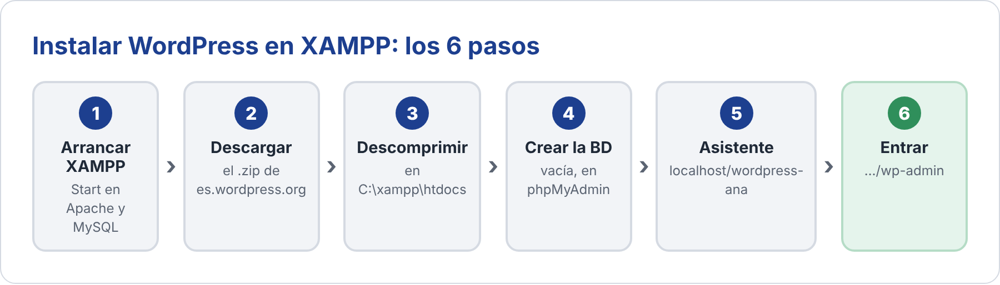
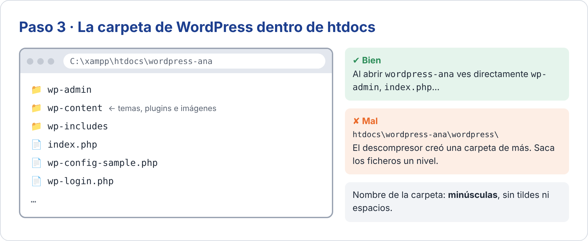
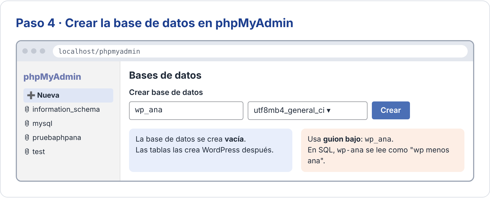
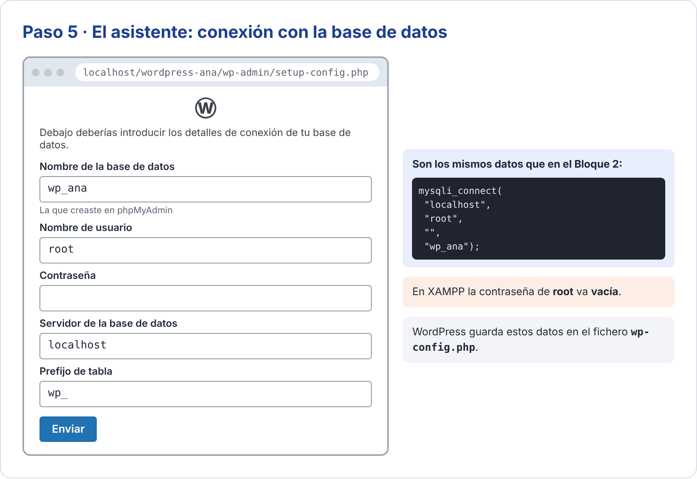
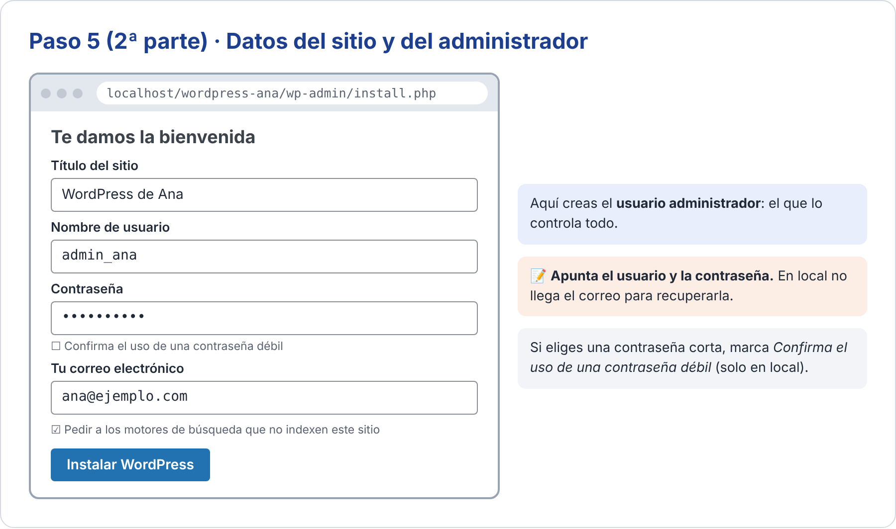
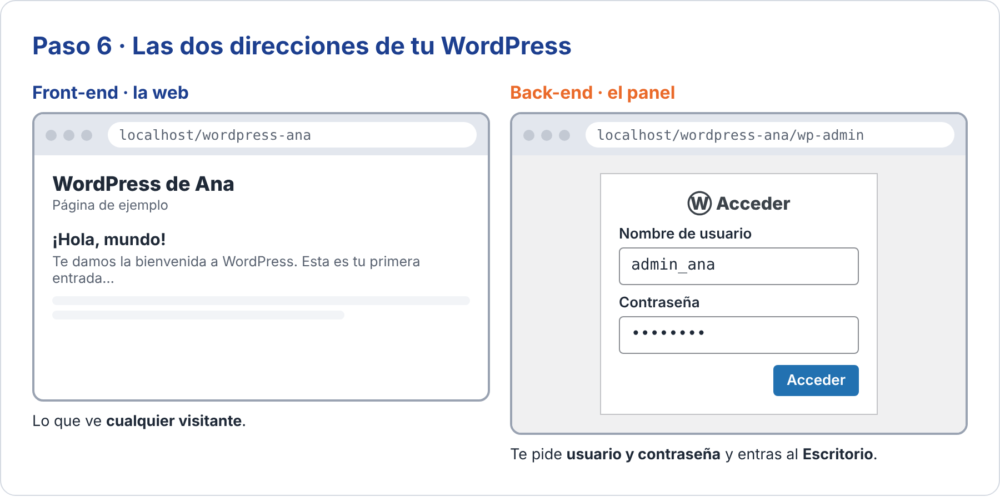
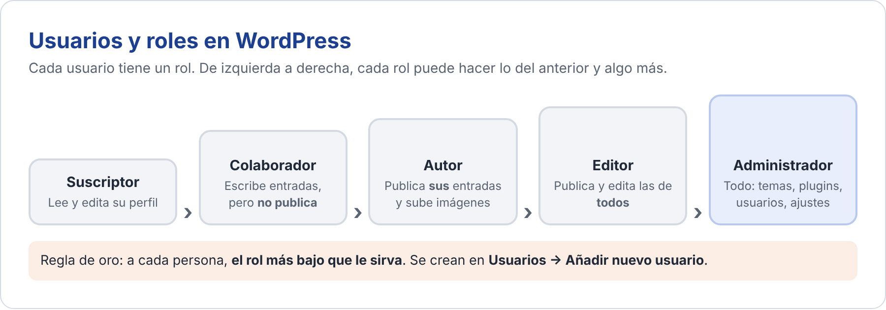

# Tema 8 — Instalación y configuración básica de un CMS: WordPress

> **Idea clave:** instalar un CMS es juntar lo que ya sabes del Bloque 2: unos **ficheros PHP** en `htdocs`, una **base de datos** en phpMyAdmin y un **asistente** que los conecta. Lo veremos con **WordPress**, el CMS más usado.

## Índice

1. [Los 6 pasos de la instalación](#1-los-6-pasos-de-la-instalación)
2. [Descargar WordPress](#2-descargar-wordpress)
3. [Requisitos](#3-requisitos)
4. [Preparar XAMPP y la carpeta](#4-preparar-xampp-y-la-carpeta)
5. [Crear la base de datos](#5-crear-la-base-de-datos)
6. [El asistente de instalación](#6-el-asistente-de-instalación)
7. [Entrar en tu WordPress](#7-entrar-en-tu-wordpress)
8. [El escritorio y los ajustes básicos](#8-el-escritorio-y-los-ajustes-básicos)
9. [Usuarios y roles](#9-usuarios-y-roles)
10. [¿Y Joomla!?](#10-y-joomla)
11. [Errores frecuentes](#11-errores-frecuentes)

---

## 1. Los 6 pasos de la instalación



En los ejemplos, la alumna se llama **Ana**. Tú pon **tu nombre**.

---

## 2. Descargar WordPress

1. Entra en [es.wordpress.org/download](https://es.wordpress.org/download/) (la versión en español).
2. Pulsa **Descargar WordPress**: se descarga un **.zip**.

> 💡 También puedes descargarlo de [wordpress.org/download](https://wordpress.org/download/), en inglés. El asistente te deja elegir el idioma al empezar.

---

## 3. Requisitos

WordPress necesita **tres cosas** en el servidor. XAMPP las trae todas:

| Necesita | Mínimo | Recomendado | En XAMPP |
|----------|--------|-------------|----------|
| **Intérprete PHP** | 7.4 | 8.3 o superior | PHP |
| **Base de datos** | MySQL o MariaDB 5.5.5 | MySQL 8.0+ o MariaDB 10.11+ | MariaDB |
| **Servidor web** | — | **Apache** o Nginx | Apache |

Fuente: [requisitos de WordPress](https://wordpress.org/about/requirements/).

> ⚠️ **Mira tu versión de PHP:** abre `http://localhost/dashboard/phpinfo.php`. Si es **7.3 o anterior**, WordPress no se instala: hay que actualizar XAMPP.

---

## 4. Preparar XAMPP y la carpeta

1. Abre XAMPP y pulsa **Start** en **Apache** y **MySQL**.
2. Descomprime el .zip. Sale una carpeta llamada `wordpress`.
3. Cópiala dentro de **`C:\xampp\htdocs\`**.
4. Cámbiale el nombre a **`wordpress-tunombre`** (por ejemplo, `wordpress-ana`).



---

## 5. Crear la base de datos

1. Abre `http://localhost/phpmyadmin`.
2. Pulsa **Nueva**.
3. Nombre: **`wp_tunombre`** (por ejemplo, `wp_ana`). Cotejamiento: **`utf8mb4_general_ci`**.
4. Pulsa **Crear**.



O con SQL, como en el Bloque 2:

```sql
CREATE DATABASE wp_ana CHARACTER SET utf8mb4 COLLATE utf8mb4_general_ci;
```

---

## 6. El asistente de instalación

Abre en el navegador **`http://localhost/wordpress-tunombre`**.

1. Elige el **idioma** → **Continuar**.
2. Te avisa de los datos que vas a necesitar → **¡Vamos a ello!**
3. Escribe los **datos de la base de datos** → **Enviar** → **Ejecutar la instalación**.



4. Escribe los **datos del sitio** y crea tu **usuario administrador** → **Instalar WordPress**.



### ¿Qué ha hecho el asistente?

- Ha creado el fichero **`wp-config.php`** con los datos de conexión:

  ```php
  define( 'DB_NAME', 'wp_ana' );
  define( 'DB_USER', 'root' );
  define( 'DB_PASSWORD', '' );
  define( 'DB_HOST', 'localhost' );
  ```

- Ha creado las **tablas** de WordPress en tu base de datos: todas empiezan por `wp_` (`wp_users`, `wp_posts`, `wp_options`...). Míralas en phpMyAdmin: ahí se guardará todo lo que publiques.

---

## 7. Entrar en tu WordPress

Tu WordPress tiene **dos direcciones**:



| Dirección | Qué es |
|-----------|--------|
| `http://localhost/wordpress-ana` | **Front-end**: la web que ve cualquiera |
| `http://localhost/wordpress-ana/wp-admin` | **Back-end**: el panel de administración, con usuario y contraseña |

> 💡 Arriba del todo hay una **barra negra**. Pulsando el nombre de tu sitio pasas de la web al panel y al revés.

---

## 8. El escritorio y los ajustes básicos

Al entrar en `/wp-admin` llegas al **Escritorio**: la página de inicio del panel. Tiene varias **cajas** con información (resumen del sitio, actividad, noticias de WordPress...) y el **menú** a la izquierda.

**Personalizar el escritorio:** arriba a la derecha está la pestaña **Opciones de pantalla**. Desde ahí marcas o desmarcas las cajas que quieres ver. También puedes **arrastrarlas** para cambiarlas de sitio.

**Ajustes básicos** (menú **Ajustes → Generales**):

| Ajuste | Qué poner |
|--------|-----------|
| Título del sitio | El nombre de tu web |
| Descripción corta | Una frase que la describa |
| Idioma del sitio | Español |
| Zona horaria | Madrid |

> 📌 El resto del menú (páginas, entradas, menús, temas, plugins...) lo trabajaremos en el **Tema 9**, y las copias de seguridad y los blogs en el **Tema 10**.

---

## 9. Usuarios y roles

Hay dos tipos de usuarios:

- **Visitantes (invitados):** navegan por la web sin registrarse. Solo leen.
- **Usuarios registrados:** entran con **usuario y contraseña**. Lo que pueden hacer depende de su **rol**.



### Crear un usuario

1. **Usuarios → Añadir nuevo usuario**.
2. Rellena **nombre de usuario**, **correo** y **contraseña**.
3. Elige el **rol** (por ejemplo, *Autor*).
4. Desmarca *Enviar al nuevo usuario un correo electrónico* (en local no se envían correos).
5. Pulsa **Añadir nuevo usuario**.

> 💡 Para probar el nuevo usuario, abre una **ventana de incógnito** y entra en `/wp-admin` con él. Verás menos menús que el administrador.

---

## Resumen

| Concepto | En una frase |
|----------|--------------|
| Instalar | Carpeta en `htdocs` + BD vacía + asistente en `localhost/wordpress-tunombre` |
| Requisitos | PHP, MySQL/MariaDB y Apache (todo viene en XAMPP) |
| `wp-config.php` | Fichero con los datos de conexión a la BD |
| Tablas `wp_` | Donde WordPress guarda todo el contenido |
| `/wp-admin` | El panel de administración |
| Roles | Suscriptor → Colaborador → Autor → Editor → Administrador |
